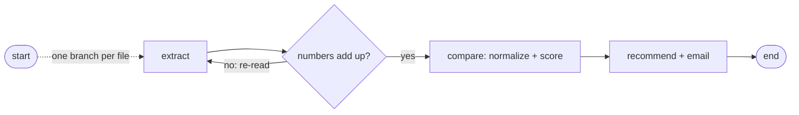

# Supplier Quote Comparison Agent

An agentic AI tool that reads supplier quotations — PDFs, scanned images or emails, in **Arabic or English** — and returns a normalized comparison, a recommendation and a ready-to-send reply to the winning supplier.

> Procurement teams often spend hours retyping quotes into Excel, converting currencies and checking whether VAT and delivery are included. This agent does it in about a minute.

## What it does

1. **Extracts** each quote in parallel (LLM + structured output): items, prices, currency, VAT, shipping, delivery, payment terms, warranty, validity, and risky conditions.
2. **Checks its own work**: if the line items, shipping and VAT don't add up to the grand total printed on the quote, the agent sees its mistakes and re-reads the document.
3. **Normalizes** every offer to **SAR including 15% VAT**, adding freight and fees. This step is plain Python, so the money math is exact and auditable.
4. **Scores and ranks** the quotes with adjustable weights (price, delivery, credit days, warranty), and flags missing information. A quote that leaves items out can never rank first.
5. **Recommends** a supplier with concrete reasons, risks and negotiation points.
5. **Drafts the reply email** to the chosen supplier and exports the comparison to Excel.

## Architecture (LangGraph)



| File | Role |
|---|---|
| `quote_agent/loaders.py` | PDF text, scanned PDF → images, images, `.eml` emails |
| `quote_agent/schemas.py` | Pydantic models (`Quote`, `QuoteRow`, `Recommendation`) |
| `quote_agent/scoring.py` | Currency/VAT normalization and weighted scoring |
| `quote_agent/graph.py` | LangGraph workflow with parallel fan-out (`Send`) |
| `app.py`, `ui.py` | Streamlit dashboard (Arabic RTL / English) |
| `quote_agent/cli.py` | Command-line runner |

The tool works with any model provider. Set `QUOTE_AGENT_MODEL` to any LangChain `provider:model` string.

## Run it

```bash
pip install -r requirements.txt
cp .env.example .env          # add a free Gemini key (aistudio.google.com/apikey)
python scripts/make_samples.py
streamlit run app.py          # then upload the 3 files in samples/
# or
python -m quote_agent.cli samples/* --lang en
```

Tests run offline with a fake LLM: `pytest -q`

## Demo scenario (`samples/`)

Three offers for 20 tons of HDPE granules:

| Supplier | Format | Headline price | Real total (SAR incl. VAT) |
|---|---|---|---|
| Gulf Polymers | PDF, SAR, excl. VAT | 4,850 / ton | 111,550.00 |
| Asia Plastics | PDF, **USD** + freight, excl. VAT | $1,240 / ton (≈4,650 SAR) | 115,143.75 |
| Al-Sharq Supply | **Arabic email**, incl. VAT, free delivery | 5,300 / ton (highest) | **106,000.00** ✅ |

The offer that looks most expensive is actually the cheapest. It also has the longest credit period (60 days) and the longest guarantee (12 months).
